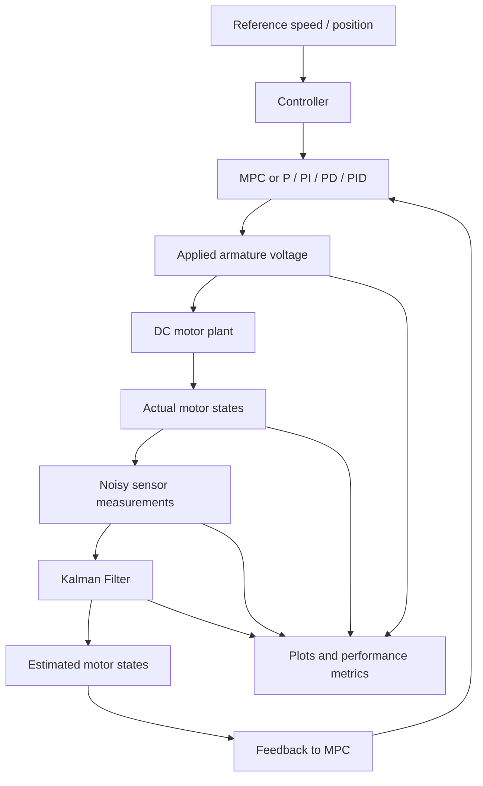

::: {align="center"}
# DC Motor Speed & Position Control

### P, PI, PD, PID, MPC + Kalman Filter


**A MATLAB simulation and interactive GUI for DC motor speed/position
control, combining classical controllers, Model Predictive Control
(MPC), and Kalman Filter state estimation.**
:::

------------------------------------------------------------------------

## 1. Project overview

This project studies DC motor speed and position control using classical
feedback controllers and Model Predictive Control. A Kalman Filter
estimates motor states from noisy sensor measurements. The estimated
states can then be used as feedback to the MPC controller.

The project focuses on two related questions:

-   How effectively can MPC regulate the motor speed or position?
-   How well can a Kalman Filter estimate motor states when measurements
    and process dynamics are noisy?

## 2. GUI preview

```{=html}
<p align="center">
```
``{=html}
```{=html}
</p>
```
*The interface shown includes MPC feedback selection,
measurement/process noise settings, Kalman Filter parameters, experiment
selection, state plots, applied armature voltage, performance metrics,
and voltage/current limit monitoring.*

## 3. Key features

  -----------------------------------------------------------------------
  Component                           Functionality
  ----------------------------------- -----------------------------------
  Control modes                       Speed control and position control

  Classical controllers               P, PI, PD and PID

  Predictive controller               Model Predictive Control (MPC)

  State estimator                     Kalman Filter (KF)

  Noise simulation                    Configurable measurement and
                                      process noise

  MPC feedback                        Direct-state MPC or MPC using KF
                                      estimates

  Visualization                       Actual, measured and estimated
                                      states; reference and applied
                                      voltage

  Performance analysis                Tracking error, ISE, control
                                      effort, estimation RMSE and limit
                                      monitoring

  Experiments                         Direct-state MPC versus KF-MPC and
                                      noise-condition studies
  -----------------------------------------------------------------------

## 4. System architecture



**Important:** The actual motor plant continues to evolve from its own
physical state. The Kalman Filter estimates that state from noisy
measurements. In KF-MPC mode, the estimate is used by the controller as
feedback; it does not overwrite the actual plant state.

## 5. DC motor mathematical model

For an armature-controlled DC motor:

\[ L_a`\frac{di_a}{dt}`{=tex}+R_ai_a+K_e`\omega`{=tex}=V_a \]

\[ J`\frac{d\omega}{dt}`{=tex}+B`\omega`{=tex}=K_ti_a \]

\[ `\frac{d\theta}{dt}`{=tex}=`\omega`{=tex} \]

Define the state vector:

\[ x=
```{=tex}
\begin{bmatrix}i_a&\omega&\theta\end{bmatrix}
```
\^{T} \]

The continuous-time state-space model is:

\[ `\dot{x}`{=tex}=Ax+Bu \]

where

\[ A=
```{=tex}
\begin{bmatrix}
-\frac{R_a}{L_a}&-\frac{K_e}{L_a}&0\\
\frac{K_t}{J}&-\frac{B}{J}&0\\
0&1&0
\end{bmatrix}
```
, `\qquad`{=tex} B=
```{=tex}
\begin{bmatrix}
\frac{1}{L_a}\\0\\0
\end{bmatrix}
```
, `\qquad `{=tex}u=V_a. \]

The sampled model can be written as:

\[ x\_{k+1}=A_dx_k+B_du_k+w_k \]

\[ z_k=Cx_k+v_k \]

where (w_k) and (v_k) represent process and measurement noise. The
measurement matrix (C) depends on the sensors enabled in the
implementation. The GUI shown provides current and speed measurements,
with an optional position sensor.

## 6. Kalman Filter formulation

The Kalman Filter estimates the motor states through prediction and
measurement correction.

**Prediction step**

\[ `\hat{x}`{=tex}*{k\|k-1}=A_d`\hat{x}`{=tex}*{k-1\|k-1}+B_du\_{k-1} \]

\[ P\_{k\|k-1}=A_dP\_{k-1\|k-1}A_d\^T+Q\_{KF} \]

**Correction step**

\[ K_k=P\_{k\|k-1}C\^T (CP\_{k\|k-1}C^T+R\_{KF})^{-1} \]

\[ `\hat{x}`{=tex}*{k\|k}=`\hat{x}`{=tex}*{k\|k-1}
+K_k(z_k-C`\hat{x}`{=tex}\_{k\|k-1}) \]

Here, (Q\_{KF}) is the process-noise covariance, (R\_{KF}) is the
measurement-noise covariance, and (P_k) is the estimation-error
covariance.

> **Do not confuse the two sets of Q and R parameters:** `Q_KF` and
> `R_KF` belong to the Kalman Filter. `Q_MPC` and `R_MPC` are MPC tuning
> weights and have different purposes.

## 7. Model Predictive Control

MPC predicts future motor behavior over a finite horizon and selects
control actions to balance reference tracking and control effort,
subject to configured constraints.

The main tuning parameters include:

-   `Q_MPC` --- tracking-error weight.
-   `R_MPC` --- control-effort weight.
-   `Np` --- prediction horizon.
-   `Nc` --- control horizon.

In **direct-state MPC** mode, the simulated motor state is supplied to
the controller. In **KF-MPC** mode, the Kalman Filter estimate is
supplied instead. This makes it possible to compare ideal
simulated-state feedback with estimated-state feedback under the same
noise conditions.

## 8. GUI sections

### MPC feedback configuration

Choose whether MPC uses the direct simulated state or Kalman Filter
state estimates.

### Measurement and process noise

Adjust measurement-noise and process-noise levels and their individual
standard deviations. A random seed is available for repeatable noise
realizations.

### Kalman Filter parameters

Tune the `Q_KF` and `R_KF` scale factors, initial covariance `P0`, and
initial estimation errors. Interpret these fields according to the
covariance construction in the MATLAB source.

### MPC / Kalman Filter experiments

Select an experiment and run it using the current settings. The
displayed GUI includes a direct-state MPC versus Kalman Filter MPC
experiment option.

### Plots and performance metrics

The interface displays: - Armature current (i_a(t)) - Angular position
(`\theta`{=tex}(t)) - Angular speed (`\omega`{=tex}(t)), including
reference speed - Applied armature voltage (V_a(t))

The metrics panel includes tracking error, ISE, control effort,
peak/maximum current and voltage, limit violations, and state-estimation
RMSE.

## 9. Example values shown in the screenshot

The table below records values visible in the supplied GUI screenshot.
They represent **one displayed simulation run only** and should not be
treated as general or final project results.

  Metric                                                   Displayed value
  ------------------------- ----------------------------------------------
  Steady-state error                 (+5.2210`\times10`{=tex}\^{-2}) rad/s
  ISE                         (4.7709`\times10`{=tex}\^{-1}) (rad/s)(\^2)s
  Control effort (J_u)              (8.8527`\times10`{=tex}\^{-1}) V(\^2)s
  RMS applied voltage                                             0.4208 V
  Peak armature current                                            0.102 A
  Maximum observed (                                                   V_a
  Estimated RMSE, current                 (1.2197`\times10`{=tex}\^{-3}) A
  Estimated RMSE, speed               (7.8171`\times10`{=tex}\^{-2}) rad/s

The run is marked **NOT settled**. The screenshot also shows voltage and
current limits as monitored but not enforced because the corresponding
MPC enforcement options are unchecked.

## 10. Suggested experiment plan

  -----------------------------------------------------------------------
  Experiment              Vary                    Evaluate
  ----------------------- ----------------------- -----------------------
  Baseline                Low measurement and     State estimation and
                          process noise           speed tracking

  Measurement-noise study Low, medium and high    Estimation RMSE and
                          measurement noise       control response

  Process-noise study     Low, medium and high    Estimation RMSE and
                          process noise           control response

  Combined-noise study    Both noise sources      KF-MPC robustness

  Feedback comparison     Direct-state MPC vs     Tracking, voltage,
                          KF-MPC                  current and estimation
                                                  metrics
  -----------------------------------------------------------------------

For a fair comparison, keep motor parameters, reference, MPC settings,
sampling time and constraints identical. Use the same random seed/noise
realization where practical.

## 11. Running the project

1.  Clone or download this repository.
2.  Open MATLAB.
3.  Open the main MATLAB `.m` GUI file.
4.  Check the source comments for the correct entry-point
    function/script and required toolboxes.
5.  Run the main file.
6.  Configure the motor, controller, noise and Kalman Filter parameters.
7.  Run a controller or experiment and inspect the plots and metrics.

**Note:** Update this section with the exact main `.m` filename and
verified toolbox requirements before publishing the repository. The
screenshot alone does not establish the entry-point filename or MATLAB
dependencies.

## 12. Suggested repository structure

``` text
DC-Motor-MPC-Kalman-Filter/
├── README.md
├── assets/
│   └── dc-motor-mpc-kalman-filter-gui.png
├── <main MATLAB GUI file>.m
├── <supporting MATLAB functions>.m
└── results/
    ├── plots/
    └── experiment-data/
```

## 13. Scope and limitations

-   This is a simulation-based project; hardware validation is not
    implied.
-   Noise settings and covariance scaling must be interpreted from the
    MATLAB implementation.
-   Monitoring a voltage/current limit is not the same as enforcing it.
    Check the enforcement settings for each experiment.
-   Results depend on motor parameters, controller tuning, initial
    conditions, sampling time and noise realization.
-   Use measured or datasheet motor parameters before drawing
    conclusions about a particular physical motor.

## 14. Future improvements

-   Validate the estimator and controller using measured motor data.
-   Generate systematic noise-sensitivity plots and comparison tables.
-   Export experiment settings, plots and metrics automatically.
-   Investigate model mismatch and sensor-failure scenarios.
-   Explore robust MPC or alternative state-estimation methods.

## Author

**AmarDeep Dwivedi**\
M.Tech --- Communication, Signal Processing and Machine Learning
(CSPML)\
IIT Dharwad

------------------------------------------------------------------------

::: {align="center"}
**DC Motor Control · Model Predictive Control · Kalman Filter State
Estimation**
:::
